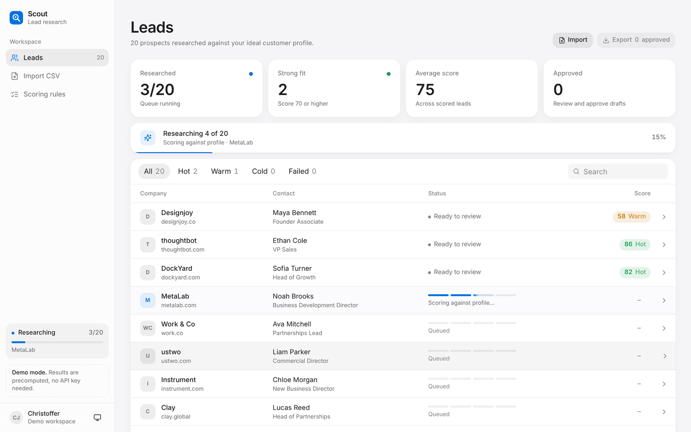

Scout

AI lead research and outreach, from a CSV to a qualified, ready-to-contact list.

Upload a list of prospects. Scout visits each company's website, works out what they do, scores how well they match your ideal customer, and drafts a short personalised opener based on something specific from their site. You review the results, edit the messages, approve the leads worth contacting and export them.

Independent portfolio project by Christoffer Jamvold-Hughes. Built to demonstrate a full-stack AI automation workflow end to end.

What it does
Import a CSV with company, website, contact_name, title and email. Each row is validated before anything runs.
Research. Scout fetches each company's homepage and extracts the readable text.
Score. An LLM rates the company from 0 to 100 against a fixed ideal customer profile and explains why, using only evidence from the website.
Draft. It writes a one- or two-sentence opener that references a real detail from the site.
Review. The leads table updates live as the queue runs. Open any lead to read the summary, see the reasoning behind its score, and edit the opener.
Export approved leads to CSV, ready for your outreach tool.
Fit tiers
Score	Fit
70–100	Strong
40–69	Good
0–39	Weak

The default profile is a B2B service company with roughly 10–200 employees, a sales team and a clear offer on its website. B2C brands, large enterprises and vague websites score lower. The criteria live in the system prompt in lib/pipeline.ts and are listed on the app's Scoring rules page.

Tech stack
Next.js 16 (App Router) and React 19, written in TypeScript
Tailwind CSS 4 with design tokens in app/globals.css, Motion for spring animation
OpenAI API with structured outputs, validated by Zod
SQLite via Drizzle ORM and better-sqlite3
Cheerio for HTML parsing, PapaParse for CSV import and export
How it works
CSV upload ──► validate rows (Zod) ──► SQLite (status: queued)
                                          │
                              background queue, one lead at a time
                                          │
                 fetch homepage ──► extract text ──► LLM (structured output)
                                                          │
                          summary · industry · size · score · reasons · opener
                                          │
                     SQLite (status: done / failed) ◄── UI polls every 1s

A few design decisions:

One LLM entry point. Every model call goes through structured() in lib/llm.ts, which returns a Zod-validated object. Swapping models or providers means changing one file.
Failures stay contained. A website that times out (10 s) or blocks the request marks that lead as failed with a reason, and the queue moves on.
Grounded output. The prompt only allows claims backed by the homepage text, and website content is treated as source material, never as instructions.
Bounded input. Only the first 4,000 characters of visible homepage text are sent, which keeps cost and latency predictable.
Design
Scout shares one visual system with my other portfolio apps, built on Apple's fluid-interface and typography guidance translated for the web: the system font stack with size-specific tracking, a single blue accent, soft tinted status pills, tabular numbers, and translucent sidebar, top bar and tab bar with content scrolling beneath.
Motion is physical and quiet. Interactive transitions use critically damped springs (motion/react) that start from the current on-screen value, so they can be interrupted. Buttons respond on press. The lead drawer enters and leaves on the right edge and can be flicked away: the release velocity carries into the spring, momentum is projected to decide whether it closes, and dragging the wrong way rubber-bands. While the queue runs, each row shows a four-step research, enrich, score, draft indicator.
It works in light and dark (follows the system, or set it from the sidebar), down to 390px wide, with visible focus states and keyboard navigation (Enter opens a lead, arrow keys step, Escape closes). Reduced motion swaps slides for cross-fades, and reduced transparency or increased contrast makes the chrome solid.
Screenshots of every screen in both themes and both sizes are in lead-research/docs/screens/, with the pre-redesign version in docs/screens/before/.

Running it locally

You need Node.js 20 or newer. An OpenAI API key is optional: without one Scout runs in demo mode (see below).

bash
git clone https://github.com/chrisjvld/AI-Lead-Agent.git
cd AI-Lead-Agent/lead-research
npm install

For real research, copy lead-research/.env.example to lead-research/.env.local and fill in:

OPENAI_API_KEY=sk-...
OPENAI_MODEL=your-model-id

Create the database and start the app:

bash
npm run db:push
npm run dev

Open http://localhost:3000, go to Import CSV and choose Try it with sample data. The sample file (seed/sample_leads.csv) contains 20 public company websites with invented contact names and example.com emails, including a few deliberate poor fits so the scoring is visible.

Demo mode. With no OPENAI_API_KEY set (or with DEMO_MODE=1), Scout does not fetch websites or call a model. Each lead walks through the same research, enrich, score and draft steps with simulated timing, using hand-written results for the sample companies (and a clearly labelled placeholder for any other row). The sidebar shows a Demo mode notice. This is for screen recordings and trying the app quickly; the code lives in lib/demo.ts and the real pipeline is unchanged. DEMO_STEP_MS sets the pace.

To test the research step on a single website from the terminal (needs an API key):

bash
npx tsx scripts/try-one.ts https://example.com

To clear all leads and start fresh:

bash
curl -X POST http://localhost:3000/api/reset
API
Method	Route	Purpose
GET	/api/leads	List all leads
POST	/api/leads/upload	Import a CSV and start the queue
GET	/api/leads/:id	Get one lead
PATCH	/api/leads/:id	Update the opener or approval
GET	/api/leads/export	Download approved leads as CSV
GET	/api/status	Whether demo mode is on
POST	/api/reset	Delete all leads
Project structure
lead-research/
  app/
    leads/            leads table and lead drawer
    upload/           CSV import
    scoring-rules/    the ideal customer profile
    api/              route handlers
  components/         UI components (shell, table, drawer, pipeline progress, buttons)
  hooks/useLeads.tsx  shared leads state and live polling
  lib/
    llm.ts            structured() wrapper around the OpenAI API
    demo.ts           demo mode: precomputed results, no key needed
    pipeline.ts       fetch, extract, score, draft, and the queue
    schema.ts         Drizzle table definition
    types.ts          Zod schemas shared by the API and UI
  scripts/try-one.ts  run the pipeline on one URL
  seed/               sample CSV
Scope

Scout is a working demo, not a hosted product. It runs locally, has no authentication, reads only each company's homepage and does not send emails. A production version would add a persistent job queue, multi-page research, contact enrichment and email verification, and a direct handoff to an outreach tool.
